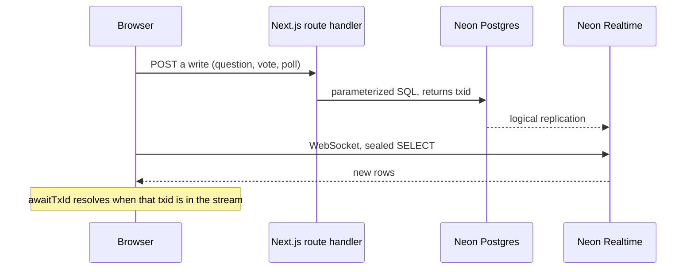

# Live Q&A

A small audience room for a live show. People open one link and ask questions, upvote, and vote in a poll. The host opens a second link and can mark questions answered, open a poll, and close it.

Reads stay live through [Neon Realtime](https://neon.com/docs/realtime/overview). Writes go through this Next.js app. There is no ORM and no user accounts in v1.

## How a change moves



Two different connections:

1. **Reads.** The browser opens one WebSocket to `NEON_REALTIME_URL`. It does not send SQL. It sends a sealed query: an encrypted, short-lived capability minted by the server. Neon Realtime runs that exact `SELECT` and pushes the rows again whenever the result changes. `useLiveQuery` from `@neon/realtime-react` owns the socket, renders the rows, and renews the seal about 10 seconds before it expires (seals last about 60 seconds).
2. **Writes.** The browser `POST`s to a Next.js route handler. The handler checks the input, runs SQL with the Neon serverless driver, and returns `pg_current_xact_id()` as text. The client calls `utils.awaitTxId(txid)` so the optimistic row stays up until that transaction shows up on the subscription.

The Realtime secret never goes to the browser. The page passes only the public WebSocket URL and the sealed query as props. Renewal is another `POST` that seals the same SQL again. That has to be a route handler, not a server action: Next.js runs server actions one at a time, which would queue renewals behind writes.

Anyone with the session id can subscribe. The id is a UUID. The host token is separate and is checked only on host writes, with a constant-time compare. v1 does not use Better Auth.

If the browser origin is missing from `neon.ts`, nothing throws. The subscription stays on **Connecting**. Add the origin and run `neon deploy` again.

## Live queries

Both queries are a single read-only `SELECT`. Parameters are `$1` placeholders. They do not call `now()` or `random()`.

- `questionsQuery(sessionId)` in `src/lib/queries.ts`: questions for the room, with `COUNT` of votes cast to `int`, ordered unanswered first, then votes descending, then oldest first. `questions.id` is a final tie-break so two questions with the same timestamp cannot swap places.
- `openPollQuery(sessionId)`: options of the oldest open poll, with vote counts, ordered by `position`. The `LIMIT 1` subquery is there so a race cannot paint two polls as one list. Creating a poll locks the session row in the same transaction, then refuses to insert while another poll is open.

The server render runs that same SQL for the first HTML. The sealed query is the same string, so the first socket snapshot replaces those rows instead of mixing two shapes. The client sorts again because a live snapshot does not promise to keep `ORDER BY`.

Vote totals are not incremented optimistically. A live snapshot already includes your vote by the time `awaitTxId` returns, and adding one on top of that snapshot would count it twice. The button still updates immediately. Asking a question, marking it answered, opening a poll, and closing it are optimistic, because those rows have ids the client chose and the update is absolute.

A poll vote can move to another option while the poll is open. The primary key is still one row per voter.

## Files

| File | Role |
| --- | --- |
| `neon.ts` | Neon config. Enables Realtime, lists allowed browser origins, leaves auth off. `neon deploy` applies it. |
| `db/schema.sql` | The approved tables. Nothing else. |
| `scripts/db-setup.mjs` | Applies `db/schema.sql` with `DATABASE_URL` from `.env.local`. |
| `.env.example` | Empty placeholders. The real file is `.env.local`, which is gitignored. |
| `src/lib/env.ts` | Reads `DATABASE_URL`, `NEON_REALTIME_URL`, and `NEON_REALTIME_SECRET` on first use. Importing it during `next build` does not read them. |
| `src/lib/db.ts` | Neon serverless HTTP client for writes and the first server read. |
| `src/lib/realtime.ts` | `createRealtime`. Holds the secret and seals queries. `debugMode` is on only in development. |
| `src/lib/queries.ts` | The two live `SELECT`s, `rawSql`, and `loadRoom` (read + seal together). |
| `src/lib/writes.ts` | Validated `INSERT` / `UPDATE` statements. Each write that changes a row returns a txid. |
| `src/lib/host.ts` | Loads `host_token` and compares it with `timingSafeEqual`. |
| `src/lib/validate.ts` | Shared limits: title, question length, 2–6 poll options, UUID checks. |
| `src/lib/rows.ts` | Turns driver rows into the shapes the UI sorts. Coerces dates and counts. |
| `src/lib/types.ts` | `QuestionRow`, `PollOptionRow`, and the write result type. |
| `src/lib/http.ts` | JSON responses with `Cache-Control: private, no-store`, and a catch-all that does not print URLs. |
| `src/lib/client-api.ts` | Browser `fetch` for writes and for renewing a seal. |
| `src/lib/ballot.ts` | Anonymous `voter_id` and this device's votes, in `localStorage`. |
| `src/app/realtime-root.tsx` | Creates one Realtime client in the browser and provides it to `useLiveQuery`. |
| `src/components/missing-room.tsx` | Shown when the session id does not match a room. Invalid ids use the real 404 page, which renders this too. |
| `src/app/layout.tsx` | Root layout, title, and the global stylesheet. |
| `src/app/globals.css` | Tailwind theme: paper background, serif headlines, live-dot pulse. |
| `src/app/page.tsx` | Home page shell. |
| `src/app/not-found.tsx` | App-wide 404 for paths that are not a page. A malformed session id renders the same message from the page, because `notFound()` in this dynamic segment currently breaks the dev render. |
| `src/app/s/[id]/loading.tsx` | Shown while the room segment loads. |
| `src/app/s/[id]/error.tsx` | Shown when the database or Realtime env is unavailable. It does not print the error text. |
| `src/components/create-session.tsx` | Creates a room and shows the audience link and the host link. |
| `src/app/s/[id]/page.tsx` | Audience route. Suspense so the shell can render before the database read. |
| `src/app/s/[id]/audience-session.tsx` | Calls `connection()`, loads the room, passes sealed queries to the board. |
| `src/app/s/[id]/host/page.tsx` | Host route. The token arrives as `?token=`. |
| `src/app/s/[id]/host/host-session.tsx` | Checks the token before rendering host controls. |
| `src/app/s/[id]/host/layout.tsx` | `noindex` and `same-origin` referrer, so the token is less likely to leak. |
| `src/components/session-board.tsx` | Subscribes to both queries, renews them, and sends writes. |
| `src/components/question-panel.tsx` | Ask box and the sorted question list. |
| `src/components/poll-panel.tsx` | Result bars, and the host form for a new poll. |
| `src/components/live-status.tsx` | Connecting / Live / Reconnecting / Stopped. |
| `src/components/copy-field.tsx` | Selects and copies a link. A relative path is copied as an absolute URL. |
| `src/app/api/sessions/route.ts` | `POST` create session. |
| `src/app/api/sessions/[id]/live/questions/route.ts` | Seals `questionsQuery` again. Renewal hits this. |
| `src/app/api/sessions/[id]/live/poll/route.ts` | Seals `openPollQuery` again. |
| `src/app/api/sessions/[id]/questions/route.ts` | Ask a question. |
| `src/app/api/sessions/[id]/questions/[questionId]/vote/route.ts` | One upvote per voter. |
| `src/app/api/sessions/[id]/questions/[questionId]/answer/route.ts` | Host marks a question answered. |
| `src/app/api/sessions/[id]/polls/route.ts` | Host creates a poll. |
| `src/app/api/sessions/[id]/polls/[pollId]/close/route.ts` | Host closes it. |
| `src/app/api/sessions/[id]/polls/[pollId]/vote/route.ts` | Vote, or move your vote, while it is open. |
| `next.config.ts` | Turns off Next's generated agent-rules files. |
| `postcss.config.mjs` | Tailwind v4 via `@tailwindcss/postcss`. |
| `eslint.config.mjs` | `eslint-config-next` flat config. `npm run lint` runs it. |

## Setup

You need Node.js 22.18 or newer and the Neon CLI (`npm i -g neon`). Realtime is in beta and only in some regions (`aws-us-east-1`, `aws-us-east-2`, `aws-eu-central-1`, `aws-ap-southeast-1`). Create the project in one of those.

```bash
git clone <this-repo>
cd <this-repo>
npm install
neon link          # pick or create a project in a Realtime region
neon deploy        # writes DATABASE_URL, NEON_REALTIME_URL, NEON_REALTIME_SECRET to .env.local
npm run db:setup   # applies db/schema.sql
npm run dev        # http://localhost:3000
```

`neon deploy` reads `neon.ts`. If Realtime is not ready before deploy stops waiting, run `neon env pull` once it is.

Open two browsers. Create a session on the home page. The audience link is `/s/[id]`. The host link is `/s/[id]/host?token=...`. The token is random and is not stored anywhere else. Copy it before you leave the page.

`npm run build`, `npm run lint`, and `npm run typecheck` do not need Neon credentials. Session pages call `connection()` before touching the database, so the build does not try to seal queries.

## Deploy on Vercel

1. Import the repo. Framework preset: Next.js.
2. Add the same three environment variables from `.env.local`: `DATABASE_URL`, `NEON_REALTIME_URL`, `NEON_REALTIME_SECRET`. Do not prefix the secret with `NEXT_PUBLIC_`. The browser receives the WebSocket URL as a prop at request time, so the build does not need it inlined.
3. Deploy once, copy the site origin (for example `https://your-app.vercel.app`).
4. Put that origin in `allowedOrigins` in `neon.ts`, next to `http://localhost:3000`.
5. Run `neon deploy` again so Realtime accepts the browser WebSocket.

Until step 5, the Vercel site can create rows, but subscriptions sit on **Connecting**.

Vercel preview deployments each have their own origin. Add each origin you actually use, or the preview will hang the same way. There is a limit of 16 origins.

## Security notes for v1

- `.env*` is gitignored. Only `.env.example` is committed, and its values are empty. Do not print `DATABASE_URL` or `NEON_REALTIME_SECRET`.
- The host link is a bearer token in the query string. `noindex` and a same-origin referrer policy reduce leaks. Treat the link like a password anyway.
- `voter_id` lives in `localStorage`. Clearing site data creates a new voter. That is enough for a show, not for an election.
- Sealed queries are bearer tokens too. They are sent over `POST` with `no-store`, not put in URLs or `localStorage`.
- Input limits are checked again on the server. The database also rejects a question body outside 1–280 characters.

## Useful checks

```bash
npm run lint
npm run typecheck
npm run build
```

To watch the SQL without the app, after `neon link`:

```bash
neon realtime subscribe "SELECT id, body, answered FROM questions"
```
